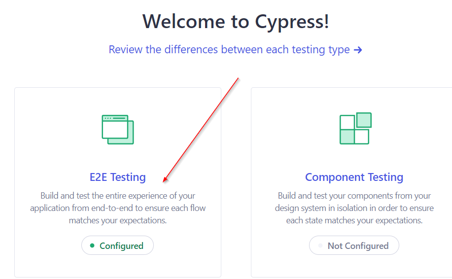
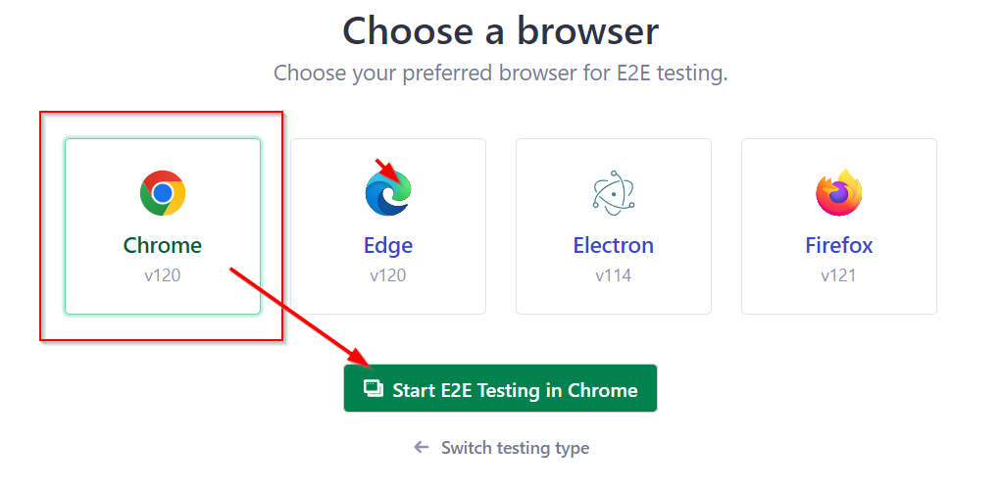
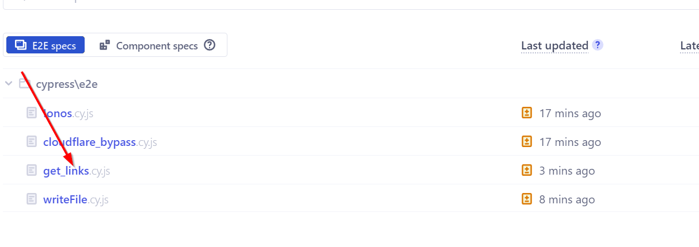

# Gudenaa

  
[](https://app.codacy.com/gh/NY-Daystar/Gudenaa/dashboard?utm_source=gh&utm_medium=referral&utm_content=&utm_campaign=Badge_grade) [!Gudenaa CI](https://github.com/NY-Daystar/Gudenaa/actions/workflows/js.yml/badge.svg?branch=main)](https://github.com/NY-Daystar/Gudenaa/actions)

[](https://github.com/NY-Daystar/Gudenaa/releases)
[](https://sourcegraph.com/github.com/NY-Daystar/gudenaa)


Cypress project to automate some actions and first of all to grab links.  
Also to get all of youtube links from a playlist

Source code analysed with [DeepSource](https://deepsource.com/)

## Summary

- [Requirements](#requirements)
- [Get Started](#get-started)
- [Debug](#debug)
    - [Use Cypress UI](#use-cypress-ui)
    - [Debug only one specification](#debug-only-one-specification)
- [Configuration for get-links script](#configuration-for-get-links)
- [For developpers](#for-developpers)
- [Formatting](#formatting)
    - [Setup Eslint](#setup-eslint)
    - [Setup Prettier](#setup-prettier)
- [Contact](#contact)
- [Credits](#credits)

### Requirements

- [NodeJS](http://nodejs.org) >= 24.0.0

## Get Started

1. Clone the repository

```bash
git clone https://github.com/NY-Daystar/Gudenaa.git
```

2. Install dependencies

```bash
npm install
```

3. Setup configuration file

```bash
cp config.sample.json config.json
```

> See [Configuration](#configuration-for-get-links) to complete config.json file

3. Execute cypress specs `get-links.cy.js`

```bash
npm run get-links
```

4. If normally executed you will get your file in the path configured in `config.json` file

## Debug

### Use Cypress UI

If you encounter problems you can debug the script like this :

1. run cypress UI

```bash
npm start
```

2. open E2E (end-to-end) specs 

3. Select navigator among (Chrome, Edge, Firefox) 
4. Select the script you want to debug (ex: `get-links.cy.js`) 

> Each change of the file will reload the cypress spec

### Debug only one specification

Example with spec file : `/cypress/e2e/ionos.cy.js`:

```bash
npm run spec --file=ionos
```

If you are on `Windows``

```bash
npm run spec:win --file=ionos
```

## Configuration for get-links

This project needs several informations to be complete in `config.json` file

Here's information needed:

- `url`: The url to scrap data
- `selector`: The selector css in the dom of `url` page to extract links
- `limit` : number of elements `to fetch` with `selector`
- `offset` : number of beggining elements `to skip` with `selector`
- `filePath`: csv filepath (relative path) where store data (**DO NOT PUT ABSOLUTE PATH**)

Exemple:

```json
{
	"url": "https://en.wikipedia.org/wiki/Peaky_Blinders_(TV_series)",
	"selector": ".mw-content-ltr.mw-parser-output > ul > li > a",
	"offset": "0",
	"limit": "0",
	"filePath": "results/peaky-blinder-characters.csv"
}
```

## Configuration for yt-playlist

This project needs several informations to be complete in `config.json` file

Here's information needed:

- `yt_api_key`: api key store in google cloud SEE [this link](https://docs.cloud.google.com/docs/authentication/api-keys)
- `playlist` : number of beggining elements `to skip` with `selector`
- `filePath`: csv filepath (relative path) where store data (**DO NOT PUT ABSOLUTE PATH**)

```json
{
	"yt_api_key": "YOUR_API_KEY",
	"playlist": "PLMhFZdf7RfEotiZ1e9lPb5LCDs-3jkZCD",

	"filePath": "results/yt-playlist.csv"
}
```

## For developpers

If you want to contribute and add new scripts, you need to place it at `cypress/e2e` folder

## Formatting

The source code is format with the `prettier` The source code is validate with `eslint`

### Setup EsLint

1. Install module

```bash
npm install -D eslint @stylistic/eslint-plugin-js
```

2. Init eslint and configure it

```bash
npm init @eslint/config
# Setup: `To check syntax and find problems`
```

> BE CAREFUL setup only `To check syntax and find problems`

3. Rules are configured in, you can add it or modified following [this guide](https://eslint.org/docs/latest/rules/)

4. To see linter errors

```bash
npm run lint
```

5. To fix them

```bash
npm run lint:fix
```

### Setup Prettier

1. Install prettier

```bash
npm install --save-dev prettier
```

2. Init configuration file `.prettierrc`

```bash
file="./.prettierrc" && [ ! -f ${file} ] && node --eval "fs.writeFileSync('${file}','{}\n')"
```

Then add rules in `package.json` file like this

```js
"prettier": {
    "semi": false,
    "singleQuote": false,
    "trailingComma": "none",
    "tabWidth": 2
  },
```

### Contact

- To make a pull request: https://github.com/NY-Daystar/doppler/pulls
- To summon an issue: https://github.com/NY-Daystar/doppler/issues
- For any specific demand by mail: luc4snoga@gmail.com

## Credits

Made by Lucas NOGA.  
Licensed under GPLv3.
